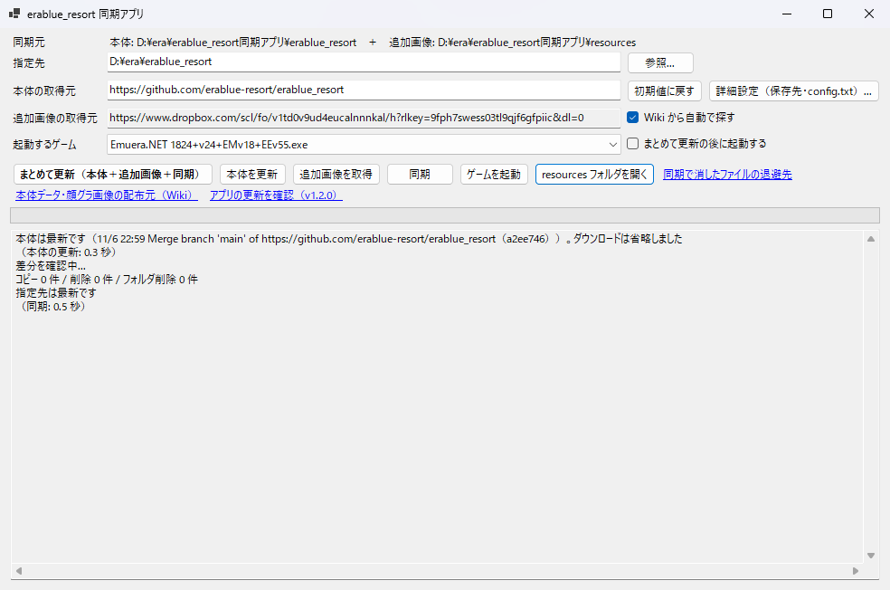

# erablue_resort 同期アプリ

era バリアント「[erablue_resort](https://github.com/erablue-resort/erablue_resort)」の
**本体更新 → 追加画像（顔グラ）取得 → ゲームフォルダへの同期** をボタン一つで行う Windows 用 GUI アプリです。



> [!NOTE]
> 非公式ツールです。erablue_resort の開発チームとは関係ありません。
> 不具合や要望はこのリポジトリの Issues へお願いします（本体側には問い合わせないでください）。

## できること

- **本体の更新**：GitHub の最新コミットと前回取り込んだコミットを比べ、変わったファイルだけを取得します（ダウンロード量は数 MB 程度）。
  変更がなければ何もダウンロードしません。差分では取れないとき（初回や大きな更新など）は zip 一括取得に切り替えます。
- **追加画像の取得**：[Wiki](https://github.com/erablue-resort/erablue_resort/wiki) に載っている Dropbox の共有フォルダから、まだ取り込んでいない zip だけを取得して展開します。
  ローカルに既にある内容の「まとめ」zip はダウンロードしません。Dropbox のフォルダが新しいものに切り替わったときは、前のフォルダの取り残しを先に取り込みます。
- **全まとめ（ギガファイル便）**：画像がまだほとんど無いとき（新しく始めるとき）は、Wiki の「顔グラ画像まとめ」（約 2.3 GB）も自動で取り込みます。途中で切れても続きから取り直します。
  画像を持っている人は「詳細設定」のボタンから取り込めます。自分でダウンロードした zip（全まとめの `resources.zip` や Dropbox のまとめ）を取り込むこともできます。
- **同期**：本体と画像（`resources`）をゲームフォルダに反映します。セーブデータ（`sav`）や `emuera.config`、ローカル改造用フォルダなどは触りません。
  同期で消したファイルは `work\削除済み\` に退避されます（最新 10 回分）。
- **ゲーム側にだけある画像を残す**：今あるゲームのフォルダを初めて同期するときは、ゲームの `resources` にだけある画像（昔の配布物や自作の画像など）を、先にアプリ側へ取り込みます。手元にある分は Dropbox からダウンロードしません。
  2 回目以降に見つかったときは、取り込んで残すか消すかを確認します。
- **まとめて更新**：上の 3 つを順に実行し、必要ならそのままゲームを起動します。ゲームの起動中は同期しません。
- **アプリ自体の更新**：起動時に新しい版を確認し、あれば更新内容を見せて「更新して再起動／今はしない／この版は飛ばす」を選べます。ダウンロードした zip は、GitHub が公開している SHA-256 と照合してから入れ替えます。
- 「詳細設定」で画像を **ハードリンク** で同期する設定にすると、アプリ側とゲーム側で画像を二重に持たずに済みます（数 GB の節約）。
  同じドライブ（NTFS）のときだけ使えます。使えないときは自動で普通のコピーになります。

詳しい使い方は [Wiki](../../wiki) を見てください。

## 動作環境

- Windows 10 / 11（x64）
- [.NET 8 デスクトップ ランタイム](https://dotnet.microsoft.com/ja-jp/download/dotnet/8.0)（「.NET デスクトップ ランタイム 8.x」の x64 版）

## 使い方

1. [Releases](../../releases/latest) から zip をダウンロードし、好きなフォルダに展開します（例：`D:\era\erablue_resort同期アプリ\`）。
2. `erablue_resort同期アプリ.exe` を起動します。
3. 「指定先」にゲームのフォルダ（`erablue_resort` フォルダ）を指定します。
   新規インストールなら、空のフォルダを指定してもかまいません。
4. 「まとめて更新（本体＋追加画像＋同期）」を押します。

初回は本体（約 50 MB）と追加画像（全まとめ約 2.3 GB と Dropbox の更新分）を取得するため時間がかかります（ゲーム側に既にある画像はダウンロードしません）。2 回目以降は差分だけです。

> [!IMPORTANT]
> 同期先のフォルダは、本体とアプリの `resources` の内容に**そろえられます**。
> ゲームの `resources` にだけある画像は、アプリ側に取り込んで残せます（初回は自動、2 回目以降は確認が出ます）。
> それ以外の場所にゲーム側だけで置いたファイルは、保護対象（下記）の中か、フォルダの直下にあるもの以外は同期で消えます（`work\削除済み\` に退避されます）。
> 自分で追加する画像は、アプリの `resources` フォルダ（「resources フォルダを開く」ボタン）に入れるのが確実です。

## フォルダ構成

exe と同じフォルダに、必要になった時点で次のファイルとフォルダが作られます。保存先は「詳細設定」で変更できます。

| パス | 内容 |
|---|---|
| `config.txt` | 設定（すべての設定がこのファイル 1 つに入ります） |
| `erablue_resort\` | 取得した本体 |
| `resources\` | 追加画像（自分で入れた画像もここへ） |
| `work\` | 作業用フォルダ。ログ（`同期アプリ_ログ.txt`）と、同期で消したファイルの退避先 |
| `同期アプリ_取込済み画像.txt` | 取り込み済みの画像 zip の記録 |

### 同期しないフォルダ（既定）

`sav`、`emuera.config`、`CSV_EDITFILE`、`CSV/ローカル追加用CSV`、`ERB_EDITFILE`、`ERB/ローカル改造用ERB`

「詳細設定」で追加・削除できます。

## 旧「erablue_resort更新アプリ」から移行する

`config.txt` は旧更新アプリ（hakino 氏作）と同じ書式で、そのまま読み込めます。
旧アプリのフォルダに exe を置けば、それまでの設定（`SourceUrl`、`OverwriteFolders`、`NoActionFolders`）を引き継ぎます。
同期アプリの設定を書き足した後も、旧アプリで読み込めます。

## ビルド

.NET 8 SDK が必要です。

```powershell
dotnet publish -c Release -o bin/publish
```

`bin/publish/erablue_resort同期アプリ.exe` が出力されます（単一ファイル。.NET 8 デスクトップ ランタイムが必要）。

## 注意事項

- 追加画像のファイル一覧の取得には、Dropbox の非公開 API（Web 版が内部で使っているもの）を使っています。
  Dropbox 側の仕様が変わると、一覧の取得に失敗することがあります。その場合はフォルダ全体の zip 一括取得に切り替えて取得を続けます。
- GitHub API は未認証で使っているため、1 時間に 60 回までという制限があります。制限に達したときは zip 一括取得で本体を更新します。
- 本体データや画像の著作権は、それぞれの作者に帰属します。このアプリは取得と配置を自動化するだけです。

## ライセンス

[MIT License](LICENSE)

## 謝辞

- [erablue_resort](https://github.com/erablue-resort/erablue_resort) の開発者・画像作者の皆さま
- 旧「erablue_resort更新アプリ」（hakino 氏作。VVII 氏作の Gitcloner を改造したもの）。設定ファイルの書式を参考にしました
